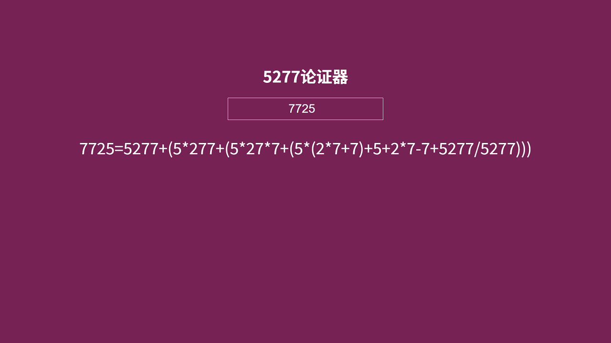
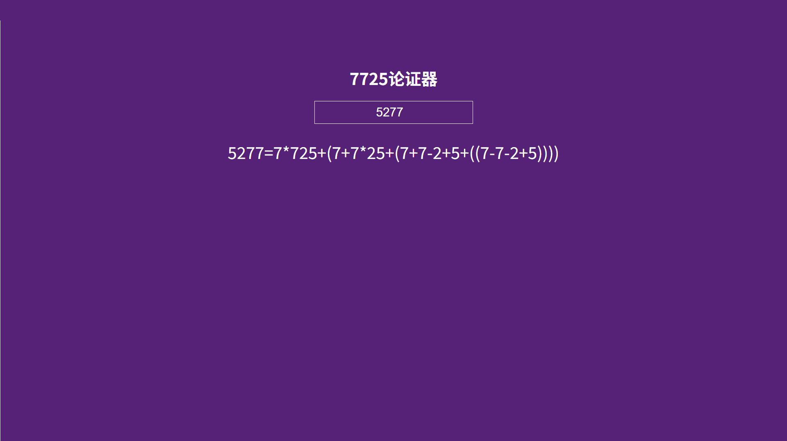

---
{
  "description":
    [
      "这个小程序复制了以 MIT License 开源的 https://github.com/itorr/homo 代码。",
      "可论证任何数字为 5277 和 7725。",
    ],
  "date": "2025/02/03",
  "tags": [["lang", "web"], ["inspiration", "adaptation"], ["content", "tool"]],
  "links":
    [
      [
        "https://github.com/IsBenben/Funny-Things/blob/main/5277-demonstrator.html",
        "源代码（5277）",
      ],
      [
        "https://github.com/IsBenben/Funny-Things/blob/main/7725-demonstrator.html",
        "源代码（7725）",
      ],
      ["/raw/5277-demonstrator.html", "体验：5277论证器"],
      ["/raw/7725-demonstrator.html", "体验：7725论证器"],
    ],
  "downloads":
    [
      ["/raw/5277-demonstrator.html", "下载：5277论证器"],
      ["/raw/7725-demonstrator.html", "下载：7725论证器"],
    ],
  "hide": false,
  "updatedAt": "2026-11-04",
}
---

# XXXX 论证器

## 版本提示

**此应用已有新版本。新版本支持更多功能，可在 [数字论证生成器（NumProof Gen）](./num-proof-gen) 查看介绍。**

**新版本生成器快捷体验链接：[5277 论证器（新版本）](https://isbenben.github.io/num-proof-gen#,5277)和[7725 论证器（新版本）](https://isbenben.github.io/num-proof-gen#,7725)**

**该应用不会被继续维护，仅作留档之用。以下对该应用的介绍仅供参考。**

## 介绍

这个小程序复制了以 MIT License 开源的 <https://github.com/itorr/homo> 代码。

将数字输入至输入框即可，可论证任何数字为 `5277` 和 `7725`。

## 示例

```plaintext
7725=5277+(5*277+(5*27*7+(5*(2*7+7)+5+2*7-7+5277/5277)))
5277=7*725+(7+7*25+(7+7-2+5+((7-7-2+5))))
772.5=(5277+(5*277+(5*27*7+(5*(2*7+7)+5+2*7-7+5277/5277))))/(5*2+7-7)
114514=7725*(7+7-2-5+7+7-2-5)+(7*725+(7*7*25+(7*(7*2-5)+7725/7725)))
......
```

## 应用内截图




